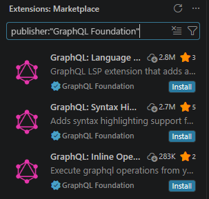

# GraphQL

GraphQL is an open‑source query language for APIs and a server‑side runtime. It provides a strongly‑typed schema to define relationships between data, making APIs more flexible and predictable. And it isn’t tied to a specific database or storage engine — it works with your existing code and data, making it easier to evolve APIs over time.

GraphQL prevents over fetching & under fetching.

## Installation

1. Install VS Code Extension: GraphQL

Previously, there was one extension, now there are 3.



2. Install Apollo Server

There are various ways to have graphql setup, one is this. Run below in your project folder.

```sh
npm init -y
npm pkg set type="module"
npm install @apollo/server graphql
```

## Topics

1. Fundamentals & Schema Definition (SDL)
- [What is GraphQL, TypeDef, Queries? How to run GraphQL?](1_simple/)
- [What is Queries, Mutations?](2_mutations)
- [What is Subscription?](3_subscription)
- Built-in scalar types (Int, Float, String, Boolean, ID)
- Custom scalar types (e.g., Date, JSON)
- Enumeration types (enum)
- Type modifiers: Nullability and Non-Null (!)
- List types and nested array nullability ([Type], [Type!], [Type!]!)
- Object types and entity relationships

2. Query Language & Operations
- Field selection sets and leaf node rules
- Arguments on fields
- Query variables and type constraints
- Aliases
- Fragments (Named fragments)
- Inline fragments and on Type conditions
- The __typename meta-field
- Built-in directives (@include, @skip)

3. Server Architecture & Resolvers
- Resolver function signature (parent, args, context, info)
- Execution pipeline (Parsing, Validation, Execution)
- Abstract Syntax Tree (AST) concepts
- Top-level query resolvers
- Field-level / Nested resolvers
- Context setup (authentication, data sources, sessions)
- Input object types (input)
- Mutation return patterns and payload design

4. Advanced Schema Types
- Interfaces
- Union types
- Runtime type resolution (__resolveType)
- Schema documentation and comments (""")
- Custom schema directives (e.g., @auth, @deprecated)
- Schema introspection (__schema, __type)

5. Performance, Data Access & Scalability
- The N+1 database problem
- DataLoader: Request batching
- DataLoader: Request caching / memoization
- Pagination: Offset-based (limit / offset)
- Pagination: Cursor-based (Relay Connections Specification: edges, node,pageInfo)
- Filtering and sorting input design

6. Errors, Security & Production Readiness
Error format (HTTP status codes vs. GraphQL errors array)

Custom errors and error masking

Partial data returns on error

Query depth limiting

Query complexity and cost analysis

Disabling introspection in production

Automatic Persisted Queries (APQ)

Rate limiting

7. Real-Time (Subscriptions)
WebSockets transport (graphql-ws protocol)

Server-Sent Events (SSE) alternative transport

PubSub engines (in-memory vs. Redis)

Subscription resolvers: subscribe vs. resolve

8. Client-Side Integration
GraphQL Client libraries (Apollo Client, urql, Relay)

Document caching vs. Normalized caching

Cache normalization keys (id + __typename)

Manual cache updates after mutations

Optimistic UI updates

TypeScript code generation (@graphql-codegen)

9. Distributed Architecture
Monolithic GraphQL vs. Microservices

Schema Stitching

Apollo Federation (Subgraphs, Supergraph, Router)

Federation core directives (@key, @external, @requires, @provides)