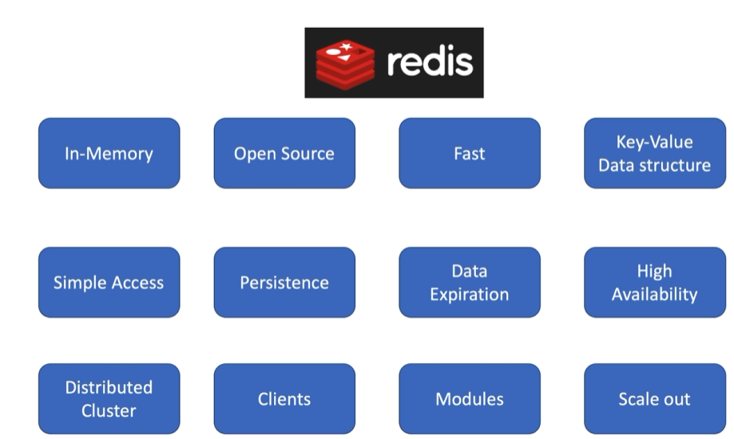

# Redis

- Redis is an open source in-memory data structure store
- Used as a database, cache and message broker
- Redis holds its entire database in memory
- Disk is used for persistent data storage
- It is a NoSQL Database and follow a key-value store concepts



### Start the Redis Server
```sh
docker run -d --name redis -p 6379:6379 redis 
```
With Config (Required for Setting Custom Config)
```sh
docker run -d --name redis -p 6379:6379 -v "D:\path\folder\redis\redis.conf:/usr/local/etc/redis/redis.conf" redis redis-server /usr/local/etc/redis/redis.conf
```

*redis.conf*
```
enable-debug-command local
```

### Start & Connect the Redis Cli(Client)
```sh
wsl -d Ubuntu redis-cli
```
OR
```sh
redis-cli -h localhost -p 6379
```
*If locally installed.*

Run `info`, `info memory`, `info clients`, `info stats`, etc. to verify client connected to server.

- Redis is a Key based data structure.
- Redis is in the family of database called "Key-Value stores".
- Key = value
- Value can be:
    - String
    - List
    - Hash
    - Sets
    - And more..
- Important: Using exact Key can value be retrieved.

## Key and values

All data in redis is built on keys.

**Set**
```sh
set <key> <value>
```
Example: `set name Dhanasvi`

**Get**
```sh
get <key>
```
Example: `get name`


    Note: If key is not set, it will return `(nil)`.

**Delete**
```sh
del name
```
Delete Multiple keys
```sh
del key1 key2 key3
```

Check
```sh
exists keyname
```
This returns integer, which is count. Number is useful, when you provide multiple keys in `exists`. It shows number of keys present.

Set key with expiration
```sh
set keyname value ex 120
```

**120** is seconds here. You can check using `ttl keyname` command. If it returns any number that is seconds before expiration and if it returns -2, it means it expired.

To set in miliseconds use `px` instead of ex. Use `pttl` this time.

Change unexpired key expire time, `expire keyname 10`. This will set to 10 seconds. To set in miliseconds, `pexpire keyname 10`.

## PERSIST

When you want to convert key which has expiration time to permanent, you do it with `PERSIST keyname`. If a keyname `ttl keyname`, returns -1, it means, it does not have expiration time.

When you do `PERSIST`, and it returns 0, that means, the key does not exist or does not have expiration time.

## Active vs Passive Keys
????

## Space
With Space, we can create different spaces in redis. Try these.

```sh
set key1 value1
select 1        // This will show you, that you are [1]
set key1 value2 
get key1        // value2
select 0        // This wont show you
get key1
```

**To view all keys.**: `keys *`

Flush all the keys of that space: `flushdb`.

    Note: You cannot link key from one space to another.

## KEYS Pattern
Pattern Matching Examples
- h?llo: Matches hello, hallo, and hxllo. (The ? matches any single character).
- h*llo: Matches hllo and heeeello. (The * matches zero or more characters).
- h[ae]llo: Matches hello and hallo, but not hillo. (Matches any one character inside the brackets).
- h[^e]llo: Matches hallo, hbllo, etc., but not hello. (Matches any character except the one after the ^).
- h[a-b]llo: Matches hallo and hbllo. (Matches any character within the specified range).

**Performance and Best Practices**
- Speed: Redis running on an entry-level laptop can scan a 1 million key database in 40 milliseconds.
- Warning: The KEYS command should only be used in production environments with extreme care, as it may ruin performance when executed against large databases.
- Alternative: Consider using the SCAN command instead.

## Shutdown server

**Shutdown server with save**
```sh
shutdown save
```

**Shutdown server without save**
```sh
shutdown nosave
```

## Rename a key

```sh
rename oldkeyname newkeyname
```

    Note: If new key name is existing keys then it will be replaced.

```sh
set fname Deepen
set lname Dhamecha
rename fname lname
get lname // Output: Deepen
```

If you do not want to rename an existing key like above use `RENAMEX`.

## Deleting Key
```sh
del key1 key2
```

Asynchronously,
```sh
unlink key1 key2
```

## Get the typoe of the key
```sh
type key1
```

## Strings

- They can be large as 512MB.
- Used for Serving static websites.
- Useful to store daily user visits, websites stats.
- Store application configurations, and master strings: app:config:title, config:countries:name, config:user:types


## Naming Convention

```sh
shop.101.name
shop.101.location
shop.101.country

keys *shop* // It will show only keys having shop.
```

## INCR & DECR

If you increment or decr a number string, it will return an integer type value with result but it will change the value and make it string again.
**Weird!**

```sh
set num 10
type num
incr num
type num
```

There is also `incrby`,
```sh
set num 10
incrby num 10
get 10 // 20
```

Some more example, **WEIRD**
```sh
set num 10
OK

get num
"10"

incr num
(integer) 11

get num
"11"

type num
string

incrby num 10
(integer) 21

get num
"21"
```

## INCR & DECR floating numbers

```sh
incrbyfloat num 1
incrbyfloat num 1.2
decrbyfloat num -1
decrbyfloat num -1.2
```

## String Operations

**APPEND**
```sh
set title "Hello"
append title " Redis"
get title // Hello Redis
```

**String Length**
```sh
strlen title
```

### MSET, MGET, MSETX

Set Multiple keys at the same time.
**MSET**
```sh
mset k1 v2 k2 v2 k3 v3
keys * // Check the keys, you should get all the keys set
```
    Note: It overwrites existing key(s) value.

Get Multiple keys at the same time
**MGET**
```sh
mget k1 k2 k3
```

**MSETNX**
If key exist, do not set the value.
```sh
mset k1 v1
OK

mget k1
1) "v1"

msetnx k1 v2
(integer) 0

mget k1
1) "v1"
```

## GETRANGE

Substring using `GETRANGE`.
```sh
set name "Deepen Dhamecha"
getrange name 0 5 // "Deepen"
getrange name 0 -4 // "Deepen Dhame"
```

    Note: Consider -1 as pointer to the right.

## SETRANGE

It leaves mentioned number of characters and then appends it.

```sh
> setrange name 7 "Dhamecha"
(integer) 15

> get name
"Deepen\x00Dhamecha"

> setrange name 6 " Dhamecha"
(integer) 15

> get name
"Deepen Dhamecha"
```

## SETEX & PSETEX

Used for setting with expiration. Search for more information.

## SETNX

Search for more information.

## ENCODING
int, raw and embstr

Search for more information.

## SCAN

`SCAN` is a cursor-based iterator used to incrementally loop over the keys in a Redis database. Its primary advantage is that it is non-blocking. Unlike the `KEYS` command, which retrieves all matching keys at once and can freeze a production server by blocking the single-threaded event loop, `SCAN` returns a small batch of keys at a time.

You start an iteration by passing a cursor value of 0. Redis responds with a two-element array containing:
- A new cursor value.
- A list of keys found during that iteration.

```sh
SCAN cursor [MATCH pattern] [COUNT count] [TYPE type]
```

- MATCH: Filters keys using a glob-style pattern (e.g., user:*). The filtering happens after Redis retrieves the batch, meaning some iterations might return an empty list of keys but a valid next cursor.
- COUNT: A hint to Redis about how much work it should do per iteration (the default is 10). It does not strictly guarantee the exact number of keys returned.
- TYPE: Filters results by the underlying data structure (e.g., string, hash, list, set).

```sh
# Start the scan with cursor 0
> SCAN 0 MATCH user:* COUNT 5
1) "17"           # The next cursor to use
2) 1) "user:123"  # The matched keys in this batch
   2) "user:456"

# Continue the scan using cursor 17
> SCAN 17 MATCH user:* COUNT 5
1) "0"            # A cursor of 0 means the entire scan is now complete
2) 1) "user:789"
```

**Important Caveats**
- Duplicates: Because Redis rehashes its dictionary as it grows or shrinks, SCAN may return the same key multiple times across different iterations. Your application logic must be prepared to handle duplicates.
- Concurrent Modifications: SCAN guarantees it will return all keys that existed continuously from the start to the end of the iteration. However, keys added or deleted while the scan is in progress may or may not be returned.

